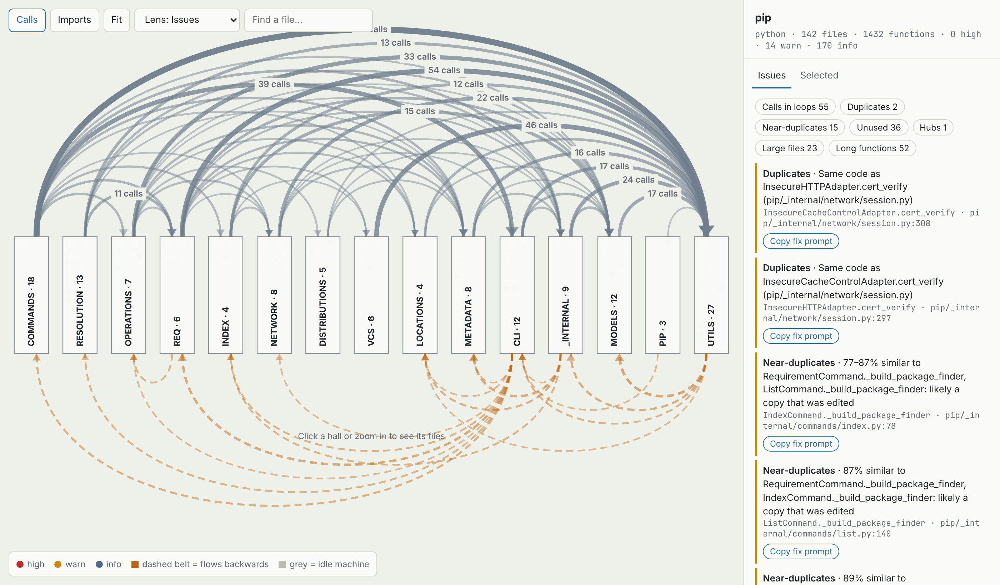

# codefactory

**See a codebase as a factory floor, find what's wrong with it, and turn that into work.**

codefactory reads a Python or TypeScript/JavaScript repository without running it, builds a map of every file,
function and call, and checks that map for copied code, database calls inside loops, dead code, import loops and
dozens of security, reliability and delivery problems. It shows the result as an interactive floor plan, writes a
technical review, ranks the fixes, and hands each one to you, or to an AI coding agent, as a ready-made task.



<sub>pip's own source (150 files), zoomed out: one hall per area of the code, one conveyor per pair of areas, labelled with
the number of calls it carries. Dashed orange conveyors run backwards, from a lower layer up into a higher one.</sub>

## What it does

- **Map.** Every file is a machine, every call between files a belt, every layer a zone. Zoom out for the halls and
  how they depend on each other; zoom in for files and functions; click a function to light up everything it calls.
- **Find.** Copied and near-copied code, N+1 database and network calls, searches inside loops, dead code, import
  loops, layer-rule breaks, untested critical code, leaked credentials, SQL built from strings, swallowed errors,
  missing timeouts, unpinned dependencies, and more. Each finding points at a `file:line`.
- **Review.** `codefactory review` writes a technical review in the shape a principal engineer would: summary,
  health grade, system map, findings by severity with evidence, what's working, gaps and open questions. No AI needed.
- **Fix.** `codefactory plan` turns findings into ranked tasks with steps and the tests to run. Each task becomes a
  self-contained prompt for Claude Code, and a baseline keeps new problems out in CI.

| | |
|---|---|
|  |  |
| **Duplication lens.** Files holding copies of each other's code, joined by arcs labelled with their similarity. | **Trace.** Everything a function eventually calls, by depth, with the total amount of code involved. |

## Quick start

Requires Python 3.11 or newer. TypeScript/JavaScript projects also need [Node.js](https://nodejs.org) and the
project's dependencies installed (`npm install`), because codefactory uses the project's own TypeScript compiler.

```bash
pip install git+https://github.com/dominickkubica/codefactory
cd path/to/your/repo

codefactory view                 # the interactive map, in your browser
codefactory review -o review.md  # a technical review of the repository
codefactory plan                 # what to fix first, ranked; then: codefactory prompt 1
```

The map is a single HTML file: no server, no network, nothing uploaded. It can be emailed or attached to a pull request.

## Commands

| Command | What it gives you |
|---|---|
| `view` | The interactive factory floor (HTML), with lenses for duplication, efficiency and size |
| `review` | A full technical review in Markdown; `--for-ai` adds an evidence pack for an AI to finish the judgement calls |
| `flags` | Every issue with `file:line`; `--min warn`, `--kind similar`, `--json`, `--github` |
| `plan` / `prompt` | Ranked tasks with steps and tests / one task as a ready-to-paste Claude Code prompt |
| `brief` / `context` | A compact map of the repo / everything about one file or function before you change it |
| `trace` / `path` | What a function eventually calls / how one function reaches another |
| `baseline` / `check` | Save today's issues / fail CI or a pre-commit hook only on new ones |
| `sarif` | Issues for GitHub code scanning and VS Code (SARIF 2.1.0) |
| `query` / `sql` | Ask anything in SQL / export the graph as a SQLite database |
| `analyze` | The raw graph as JSON |
| `skill` | Teach Claude Code in a repository when and how to use all of the above |

Commands that take a name work from inside the repository: `codefactory context checkout`. After the first run,
results come from a cache (`.codefactory/`, ignored by git) until a source file changes, so repeated questions answer
in well under a second.

## With Claude Code

```bash
codefactory skill      # once per repository; commit .claude/skills/codefactory/SKILL.md
```

Then ask in plain words: *"what should I clean up first?"*, *"review the codebase"*, *"what breaks if I change
`useCart`?"*, *"did my change add any problems?"*. Claude Code runs the right command, reads a few thousand tokens of
findings instead of the whole repository, and verifies each change with the tests codefactory lists.

## How far to trust it

Analysis is static: nothing is executed. The TypeScript analyzer uses the TypeScript type checker, so it follows
imports through path aliases, methods on typed objects, functions handed out by React hooks, JSX components and lazy
`require()`. The Python analyzer resolves imports, `self` and class methods, callbacks and dispatch tables. Calls
made through untyped objects or reflection can be missed, so "unused" and "no test reaches it" are reported as hints,
and anything intentional can be silenced with a comment that states why:

```ts
// codefactory: ignore io_in_loop — one query per table, and there are seven
```

On a 600-file React Native app, a full analysis takes about 30 seconds; Python runs at about 15 ms per file.

## Documentation

- [Usage guide](docs/USAGE.md): every command, the viewer, every check, configuration, CI and Claude Code
- [Design](docs/DESIGN.md): how it works and why, data model, algorithms, trade-offs and limits
- [Changelog](CHANGELOG.md) · [Contributing](CONTRIBUTING.md)

## Status

Actively developed and used on real projects; at version 0.7. Python and TypeScript/JavaScript are supported;
more languages are on the [roadmap](docs/DESIGN.md#roadmap). No license has been chosen yet, so all rights are
reserved until one is.
