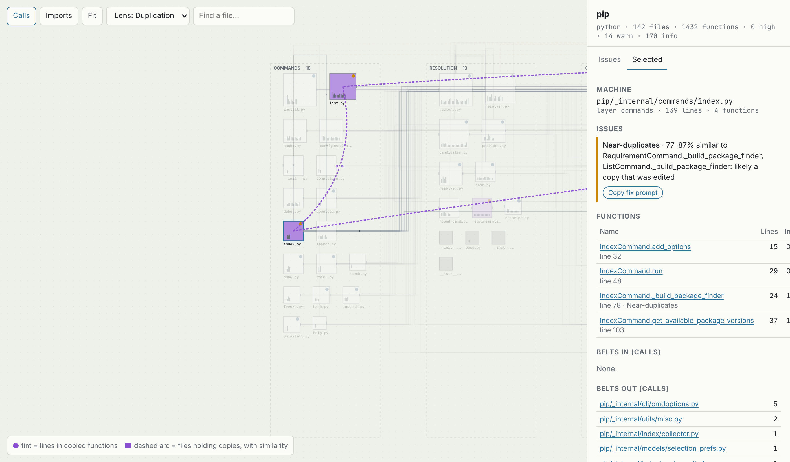
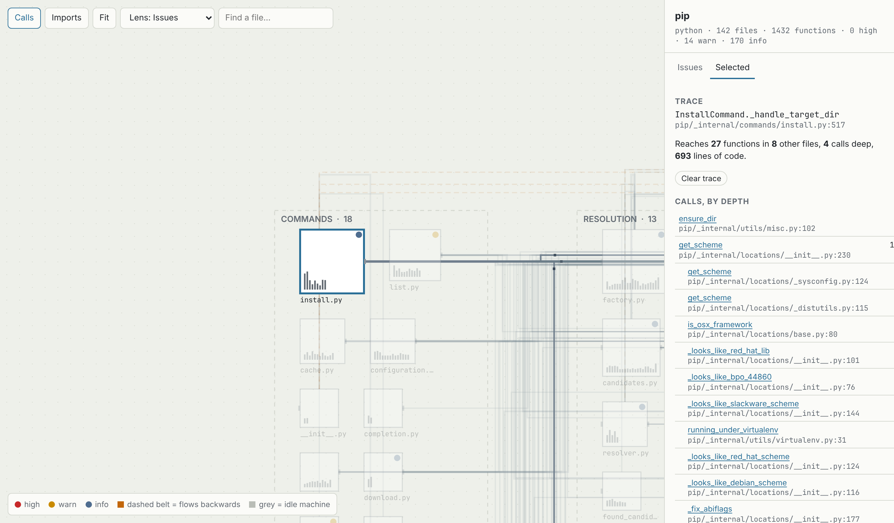

# codefactory

[](https://github.com/dominickkubica/codefactory/actions/workflows/ci.yml)
[](LICENSE)


**See a codebase as a factory floor, find what's wrong with it, and turn that into work.**

codefactory reads a repository without running it, builds a map of every file, function and call, and checks that
map for copied code, database calls inside loops, dead code, import loops and dozens of security, reliability and
delivery problems. It shows the result as an interactive floor plan, writes a technical review, ranks the fixes, and
hands each one to you, or to an AI coding agent, as a ready-made task.

It works on Python, TypeScript/JavaScript, Go, Java, Kotlin, Swift, Rust, C/C++, C#, Ruby, PHP and more, runs
entirely on your machine, and needs no account, server or API key.


<sub>pip's own source (150 files), zoomed out: one hall per area of the code, one conveyor per pair of areas, labelled with
the number of calls it carries. Dashed orange conveyors run backwards, from a lower layer up into a higher one.</sub>

## Quick start

```bash
pip install "codefactory[languages] @ git+https://github.com/dominickkubica/codefactory"
cd path/to/your/repo

codefactory review -o review.md  # a technical review of the repository
codefactory view                 # the interactive map, in your browser
codefactory plan                 # what to fix first, ranked; then: codefactory prompt 1
```

- **Python 3.11 or newer.** On Windows, run the same commands in PowerShell; use `py -m pip` if `pip` isn't found.
- **TypeScript/JavaScript projects:** run `npm install` in the project first, because codefactory uses the project's
  own TypeScript compiler (needs [Node.js](https://nodejs.org)). Without it, those files are still analyzed, less
  precisely.
- **`[languages]`** adds the tree-sitter language pack for everything beyond Python and TypeScript. Leave it out for
  a dependency-free install.
- **Upgrade any time** with `codefactory update`.

## What it does

- **Map.** Every file is a machine, every call between files a belt, every layer a zone. Zoom out for the halls and
  how they depend on each other; zoom in for files and functions; click a function to light up everything it calls.
- **Find.** Each finding points at a `file:line` and says what to do about it:

  | Area | Examples |
  |---|---|
  | Performance | Database or network calls once per item (N+1), searches inside loops over loaded data, writes outside a transaction |
  | Duplication | Identical and near-identical functions, merged into one task per group |
  | Structure | Import loops, layer-rule breaks, unused code, functions nobody tests, very long or complex functions |
  | Security | Leaked credentials, SQL built from strings, `eval`, shell strings, disabled TLS checks, plain HTTP |
  | Reliability | Swallowed errors, network calls without a timeout, missing error boundaries |
  | Delivery | No CI or CI without tests, floating dependency versions, no lockfile, no runtime pin |

- **Review.** `codefactory review` writes a technical review in the shape a principal engineer would: summary,
  health grade, system map, findings by severity with evidence, what's working, gaps and open questions. No AI needed.
- **Fix.** `codefactory plan` turns findings into ranked tasks with steps and the tests to run. Each task becomes a
  self-contained prompt for Claude Code, and a baseline keeps new problems out in CI.

| | |
|---|---|
|  |  |
| **Duplication lens.** Files holding copies of each other's code, joined by arcs labelled with their similarity. | **Trace.** Everything a function eventually calls, by depth, with the total amount of code involved. |

## Languages

| Language | How calls are resolved | Notes |
|---|---|---|
| Python | Precisely: imports, `self`/`cls`, classes, re-exports, dispatch tables, `getattr` | Standard library only |
| TypeScript, JavaScript | Precisely: the project's own TypeScript type checker (path aliases, hooks, JSX, lazy `require`) | Needs Node.js and `npm install` |
| Go, Java, Kotlin, Swift, Rust, C, C++, C#, Ruby, PHP, Scala, Dart, Lua, Elixir and more | By name, through tree-sitter | `[languages]` install; grammars download once, then work offline |

For the by-name languages, call, impact and unused-code findings are leads to confirm, and the review says so.

## Commands

| Command | What it gives you |
|---|---|
| `review` | A full technical review in Markdown; `--for-ai` adds an evidence pack for an AI to finish the judgement calls |
| `view` | The interactive factory floor (one HTML file), with lenses for duplication, efficiency and size |
| `flags` | Every issue with `file:line`; `--min warn`, `--kind similar`, `--json`, `--github` |
| `plan` / `prompt` | Ranked tasks with steps and tests / one task as a ready-to-paste Claude Code prompt |
| `accept` | Mark a finding as intended, with the reason, so later runs show only what's new |
| `brief` / `context` | A compact map of the repo / everything about one file or function before you change it |
| `trace` / `path` | What a function eventually calls / how one function reaches another |
| `baseline` / `check` | Save today's issues / fail CI or a pre-commit hook only on new ones |
| `sarif` | Issues for GitHub code scanning and VS Code (SARIF 2.1.0) |
| `query` / `sql` | Ask anything in SQL / export the graph as a SQLite database |
| `analyze` | The raw graph as JSON |
| `skill` | Teach Claude Code in a repository when and how to use all of the above (`--hook`: keep it current) |
| `update` | Upgrade codefactory to the latest version |

Commands that take a name work from inside the repository: `codefactory context checkout`. `codefactory --help` and
`codefactory <command> --help` list every option.

## With Claude Code

```bash
codefactory skill --hook   # once per repository; commit .claude/
```

This writes a skill (`.claude/skills/codefactory/SKILL.md`) and a session-start hook. Every Claude Code session in
that repository, on your machine or in the cloud, then starts with codefactory installed, upgraded at most once a
day, and its instructions matching the installed version.

Then ask in plain words: *"what should I clean up first?"*, *"review the codebase"*, *"what breaks if I change
`useCart`?"*, *"did my change add any problems?"*. Claude Code runs the right command, reads a few thousand tokens of
findings instead of the whole repository, and verifies each change with the tests codefactory lists.

## In CI

Fail a pull request only on problems it adds, with annotations on the changed lines:

```yaml
# .github/workflows/codefactory.yml (after `codefactory baseline` is committed)
- run: pip install "codefactory[languages] @ git+https://github.com/dominickkubica/codefactory"
- run: codefactory check --github
```

`codefactory sarif -o codefactory.sarif` feeds GitHub code scanning instead. The [usage guide](docs/USAGE.md#keeping-new-problems-out-baseline-and-check)
has complete workflows.

## How far to trust it

Analysis is static: nothing is executed. Most of codefactory's accuracy came from running it on real projects and
fixing what it got wrong: each false positive got a test before its fix, and snapshot tests of every finding on
three sample apps make any change in output visible in CI.

- **Checked on real code** in each language family: two production apps (React Native, FastAPI), pip, Python's and
  Go's standard libraries, Apache commons-lang (Java), OkHttp (Kotlin) and Rack (Ruby).
- **Hints are labelled as hints.** Calls through reflection or untyped objects can be missed, so "unused" and "no
  test reaches it" are reported as leads to verify.
- **Measured where it can be.** With a coverage report in the repository (`coverage/lcov.info`, Istanbul's
  `coverage-final.json`, coverage.py's `coverage.json`), "untested" comes from what actually ran. Without one, the
  call-graph estimate matched Jest's real coverage for 97.6% of functions on a 500-file React Native app.
- **Intended findings stay quiet.** Mark them once, in the code or from the command line, and say why:

  ```ts
  // codefactory: ignore io_in_loop — one query per table, and there are seven
  ```
  ```bash
  codefactory accept sql_built src/db/encrypt.ts --why "the key is 64 hex characters we generate"
  ```

## Speed

Files are parsed on every core and cached one by one, so a repeat run re-reads only what changed:

| Codebase (full review, 4 cores) | First run | One file changed | Nothing changed |
|---|---|---|---|
| A React Native app, 500 files, 33k lines | 14 s | 3 s (14 s for a TypeScript file\*) | 3 s |
| Python's standard library and packages, 3,900 files, 1.7M lines | 48 s | 21 s | 5 s |
| Go's standard library, 6,000 files, 2.4M lines | 65 s | | |

\*The TypeScript type checker needs the whole program, so a TypeScript change re-runs it. Other commands (`flags`,
`brief`, `context`, `plan`) answer from the cache in well under a second when nothing changed.

## Privacy

Everything runs locally and nothing is uploaded. The map is a single HTML file with no network access. The only
network use is the install itself, `codefactory update`, and tree-sitter grammars downloading the first time a
language is analyzed. Caches live in `.codefactory/` inside the repository, which ignores itself in git.

## Documentation

- [Usage guide](docs/USAGE.md): every command, the viewer, every check, configuration, CI and Claude Code
- [Design](docs/DESIGN.md): how it works and why, data model, algorithms, trade-offs and limits
- [Changelog](CHANGELOG.md) · [Contributing](CONTRIBUTING.md)

## Status and license

Version 0.10, actively developed and used on real projects. Issues and pull requests are welcome; see
[Contributing](CONTRIBUTING.md). [MIT licensed](LICENSE): use it, change it, share it.
