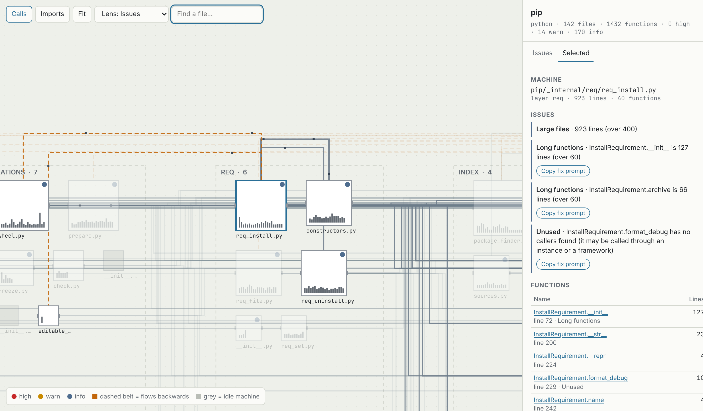

# Usage guide

Everything codefactory can do, how to read what it tells you, and how to fit it into your workflow.

- [Installing](#installing)
- [The factory view](#the-factory-view)
- [What it flags](#what-it-flags)
- [The technical review](#the-technical-review)
- [From issues to fixes: plan and prompt](#from-issues-to-fixes-plan-and-prompt)
- [Silencing what's intended](#silencing-whats-intended)
- [Keeping new problems out: baseline and check](#keeping-new-problems-out-baseline-and-check)
- [Issues on the line: SARIF and annotations](#issues-on-the-line-sarif-and-annotations)
- [Working with Claude Code](#working-with-claude-code)
- [Asking questions: trace, path, context, SQL](#asking-questions-trace-path-context-sql)
- [Configuration: factory.toml](#configuration-factorytoml)
- [Troubleshooting](#troubleshooting)

## Installing

```bash
pip install git+https://github.com/dominickkubica/codefactory     # or, from a clone: pip install -e .
codefactory --version
```

- **Python 3.11+**, no Python dependencies.
- **TypeScript / JavaScript** also needs [Node.js](https://nodejs.org) and the `typescript` package. codefactory uses,
  in order: the analyzed project's own `node_modules/typescript` (so `npm install` in the project is enough), a global
  install (`npm install -g typescript`), or the folder in the `CODEFACTORY_TYPESCRIPT` environment variable. Without
  any of them, Python is still analyzed and TypeScript is skipped with a note.
- `python -m codefactory …` works the same as `codefactory …`.

Every command takes the repository as an optional path (default: the current folder). Commands that take a name
(`context`, `trace`, `path`, `prompt`, `query`) take the path first when you give one: `codefactory trace path/to/repo checkout`.

## The factory view

```bash
codefactory view                          # writes factory.html here and opens it
codefactory view -o ~/Desktop/map.html    # somewhere else
```

| On the floor | In the code |
|---|---|
| **Zone (hall)** | A layer: a top-level folder (`api/`, `db/`…), a layer you define in `factory.toml`, or, for a flat project, a level of import depth. A zone holding most of the code is split by its next folder level. |
| **Machine** | A file. Its size is its line count; the bars inside are its functions. |
| **Belt** | Calls (or imports) between two files. Thicker means more call sites; moving dots show the direction. |
| **Dashed orange belt** | A dependency that runs backwards, from a lower layer up into a higher one. |
| **Grey machine** | Idle: nothing calls in or out. |
| **Status light** | The machine's most severe issue: red = high, amber = warn, blue = info. |

Zones run left to right from code that uses others (screens, routes, commands) to code everything relies on (data
access, utilities).

**Zoomed out**, a large codebase shows as halls, each with a summary card (files, functions, lines, issue counts,
most-used files) and one conveyor per pair of halls, labelled with the calls it carries. Hover a hall to see only its
conveyors; click it, or scroll in, and the halls fade into their machines.



**Zoomed in:** hover a machine to see only its belts; click it for its functions (lines, callers, callees), its issues
and its neighbours. Click a function name to **trace** it: the floor zooms to what it reaches and dims everything
else, and the panel lists each call by depth with the total lines involved.

**Controls:** drag to pan, scroll to zoom, `f` to fit, `Esc` to clear. *Calls / Imports* switches what belts show.
*Tests* shows or hides test files (hidden at first when they're a large share of the code). *Find a file* jumps to a
file. The *Issues* tab lists every finding with a filter per kind; clicking one flies to its machine, and every issue
has a **Copy fix prompt** button.

**Lenses** recolour the floor for one kind of problem:

- **Duplication:** machines tinted by how many lines sit in copied functions; dashed arcs join files that hold copies
  of each other, labelled with their similarity. Clicking a copy lights up every copy.
- **Efficiency:** machines tinted by loop problems; belts that carry a loop's calls into database or network code
  turn red; a drum marks files that do I/O. Hall cards count N+1 loops per layer.
- **Size:** machines tinted by lines of code.

## What it flags

| Issue | Severity | Meaning |
|---|---|---|
| `cycle` | high | Files that import each other in a circle, counting only imports that run when a module loads (not imports inside functions or under `TYPE_CHECKING`, which are often placed there to break a loop). |
| `layer_violation` | high | An import that `factory.toml` forbids, such as `ui -> db`. |
| `io_in_loop` | warn / info | A database, network or file call, or a call into the codebase that eventually makes one, runs once per loop iteration. Reads and network calls are warn (the N+1 pattern); writes and file operations are info. Loops over a list fixed in the code (a literal, a constant, `Object.entries(CONST)`, `range(5)`, `.slice(0, 10)`) and loops in migrations are info, because they can't grow with the data. |
| `duplicate` | warn | Functions with the same structure and the same literal strings and numbers, even with renamed variables (at least 6 lines). |
| `similar` | warn / info | Copies that were edited afterwards: 75% or more of their structure in common; 85% or more is warn. |
| `quadratic_scan` | info | `find`, `filter`, `includes`, `indexOf`… on an array inside a loop: O(n²) as the list grows. Searches in a list written out in the code don't count. |
| `sequential_await` | info | Awaits inside a loop, each waiting for the previous one; independent ones could run together. |
| `unused` | warn / info | Functions nothing calls or references. Methods are only info, and never reported when their name is called on some object elsewhere or when a framework calls them by name (React lifecycle methods, web components, Angular, Django/DRF). Lazy `require()` / `import()` counts as a use, and so does a dispatch table (`COMMANDS[name](…)`). |
| `test_only` | info | Code that only tests call: dead in the product, kept alive by its tests. |
| `hub` | info | A function called from 12 or more files. |
| `large_file` / `long_function` | info | Over 400 / 60 lines. |
| saved queries | your choice | Any SQL check you add in `factory.toml` (see [SQL](#asking-questions-trace-path-context-sql)). |

```bash
codefactory flags                          # everything, file:line
codefactory flags --min warn               # leave out the info-level notes
codefactory flags --kind similar --kind duplicate
codefactory flags --json                   # for scripts and agents
codefactory flags --silenced               # what's been silenced, and why
```

## The technical review

```bash
codefactory review -o review.md
codefactory review --for-ai -o review-for-ai.md
```

The report has the structure of a principal engineer's review:

1. **Executive summary:** what the system is (framework, size, layers, data stores, external services, test reach,
   CI), overall health as *Strong*, *Adequate*, *Fragile* or *At risk* with what drives the grade, and the top five
   actions with effort.
2. **System map:** layers and how much they call each other, trust boundaries, most-depended-on code.
3. **Findings** by severity (Critical, High, Medium, Low), each with `file:line` evidence, impact, a fix and an effort.
4. **What is working.**
5. **Testing and release gaps.**
6. **Open questions** for the team.
7. **Review limits:** what was and wasn't analyzed.

Besides everything in [What it flags](#what-it-flags), the review checks:

| Area | Checks |
|---|---|
| Security | credentials in source, committed `.env` files, SQL built from strings (naming what's interpolated), `eval` / `exec` / `pickle` / unsafe YAML, shell commands built at runtime, TLS verification turned off, raw HTML injection, plain-HTTP URLs |
| Reliability | swallowed errors, a React UI without an error boundary, network calls without a timeout, module-level mutable state |
| Testing | no tests at all; which important code (code doing I/O, or called from many files) no test reaches, from the call graph |
| Delivery | CI present, what it runs, whether it runs on pushes; lockfile; dependencies on `*` / `latest` / git; unpinned Python requirements; runtime version pinned; README with run instructions |

**`--for-ai`** appends an evidence pack: instructions for an AI reviewer, and the code of the riskiest functions
(those that delete databases or files, swallow errors, branch a lot, do I/O, and that no test reaches). An AI confirms
or rejects each finding from its cited lines and judges the risky code, reading a few thousand tokens instead of the
whole repository.

The review can't judge intent, product context, or runtime and concurrency behaviour that no rule describes. The
evidence pack exists to point an AI or a person at exactly that code.

## From issues to fixes: plan and prompt

```bash
codefactory plan                 # top 10 tasks; --top 30 for more, --json for tools
codefactory prompt 1             # task 1 as a prompt (or by its id: codefactory prompt c24b1d)
```

`plan` groups related issues into one job each:

- a group of copies becomes **one merge**: it picks which copy to keep (from the layer the others' callers can import)
  and lists every caller to repoint;
- a function's calls in loops become **one batching job**, naming the function that needs a batched version;
- dead code becomes **one cleanup**.

Each task lists its steps, the tests that exercise the code, and a command that confirms it's done. Scores favour
severity, lines saved and number of callers; tests and one-off scripts count for less.

`prompt` prints the task as a self-contained brief for Claude Code: what, where, why, the steps, constraints (keep
behaviour identical, update every caller of anything renamed) and how to know it's done. The viewer's **Copy fix
prompt** button copies the same text.

## Silencing what's intended

A loop over seven tables, a deliberate copy in a build script, a method a framework calls by name: when a finding is
intended, say so in the code, next to it. A comment on the function's line, the flagged line, or the line above
either, in any comment style:

```ts
// codefactory: ignore io_in_loop — one query per table, and there are seven
// codefactory: ignore unused, test_only: called by the router by name
// codefactory: ignore — every issue on this function
// codefactory: ignore-file duplicate — generated code     (anywhere in a file: applies to the whole file)
```

or in `factory.toml`:

```toml
[[silence]]
kind = "io_in_loop"          # or "*" (the default)
where = "src/db/backup.ts"   # a file or file::function glob
reason = "bounded by the number of tables"
```

Silenced issues leave the list but not the record: `codefactory flags --silenced` shows each one with its reason, and
SARIF output includes them as suppressed.

## Keeping new problems out: baseline and check

```bash
codefactory baseline     # writes codefactory-baseline.json: commit it
codefactory check        # exit 1 if there are issues the baseline doesn't have
```

An issue is identified by its kind, file and function, not its line, so moving code around doesn't count as new.
`check` also reports what has been fixed since the baseline; run `baseline` again after a cleanup to lock the gains
in. `check --fail-on high` fails only on new high-severity issues (the default is warn). Without a baseline, `check`
fails on any high-severity issue.

**GitHub Actions:**

```yaml
# .github/workflows/codefactory.yml
on: pull_request
jobs:
  structure:
    runs-on: ubuntu-latest
    steps:
      - uses: actions/checkout@v4
      - uses: actions/setup-python@v5
        with: { python-version: "3.12" }
      - uses: actions/setup-node@v4          # TypeScript / JavaScript projects
        with: { node-version: 22 }
      - run: npm ci                          # the project's own typescript
      - run: pip install git+https://github.com/dominickkubica/codefactory
      - run: codefactory check --github      # annotates new issues on the pull request, and fails on them
```

**Pre-commit hook:** put `codefactory check` in `.git/hooks/pre-commit`. After the first run unchanged code comes from
the cache, so it's quick.

## Issues on the line: SARIF and annotations

```bash
codefactory sarif --min warn -o codefactory.sarif
```

SARIF 2.1.0 is the format GitHub code scanning, VS Code and most CI tools read. The output validates against the OASIS
schema and includes every issue plus the review's line-level checks, with a rule per kind (help text and a fix;
security rules carry a `security-severity`), links between related places (each copy links to the others), stable
fingerprints so an alert follows its code through edits, silenced issues as suppressed with your reason, and, when a
baseline exists, `new` or `unchanged` on every result (`--new` keeps only new ones).

- **GitHub code scanning** (free for public repositories; private ones need GitHub Advanced Security):

  ```yaml
        - run: codefactory sarif --min warn -o codefactory.sarif
        - uses: github/codeql-action/upload-sarif@v3
          with: { sarif_file: codefactory.sarif, category: codefactory }
  ```

- **Without code scanning:** `codefactory check --github` (new issues) or `codefactory flags --github --min warn` (all)
  print GitHub Actions annotations, which appear on the pull request's changed lines on any plan.
- **VS Code:** install Microsoft's *SARIF Viewer* extension and open the file.

## Working with Claude Code

```bash
codefactory skill        # writes .claude/skills/codefactory/SKILL.md; commit it
```

The skill tells Claude Code which command answers which question and how to read each finding, including which ones
are only hints. In practice:

| You say | Claude runs |
|---|---|
| "What should I clean up first?" | `codefactory plan`, then works through `codefactory prompt 1`, `2`, … |
| "Review the codebase." | `codefactory review --for-ai`, then confirms each finding from its cited lines |
| "What breaks if I change `useCart`?" | `codefactory context useCart` (callers, impact, tests to run) |
| "How does checkout end up writing to the database?" | `codefactory path checkout save_order` |
| "Did my change add any problems?" | `codefactory check` |

Every command prints `file:line`, and `--json` is available on `flags`, `plan`, `context`, `trace`, `path` and `query`.

**Cloud sessions** (Claude Code on the web) start from a fresh machine each time, so codefactory has to be installed
there too: add a setup script with the `pip install` line above to the cloud environment.

## Asking questions: trace, path, context, SQL

```bash
codefactory context useCart               # callers, calls, impact, tests that exercise it, its issues
codefactory context src/db/orders.ts      # the same for a file: its functions, importers, imports
codefactory trace checkout                # everything checkout() eventually calls, by depth
codefactory path checkout save_order      # the shortest call chain from one to the other
codefactory brief                         # a compact Markdown map of the whole repository
```

**SQL.** `codefactory query "…"` runs a query on the graph (built in memory); `codefactory sql -o graph.db` exports it.

| Table / view | Columns |
|---|---|
| `files` | id, module, loc, layer |
| `functions` | id, file, name, qualname, line, end_line, loc, kind, decorated, exported, dynamic |
| `edges` | src, dst, kind (`call`, `ref`, `import`), count |
| `flags` | kind, severity, target, message, line |
| `function_stats` (view) | id, file, qualname, loc, fan_in, fan_out, caller_files |
| `file_deps` (view) | src_file, dst_file, calls |

```sql
-- large functions many files depend on: the riskiest code to change
SELECT qualname, file, loc, caller_files FROM function_stats
WHERE loc > 40 AND caller_files >= 5 ORDER BY caller_files DESC;
```

Saved queries become checks. Each row returned is one issue: a `target` column (a file or function id), an optional
`message`, and any other columns appended to the message.

```toml
[[queries]]
name = "risky_hub"
severity = "warn"
message = "Large function called from many files"
sql = "SELECT id AS target, loc, caller_files FROM function_stats WHERE loc > 40 AND caller_files >= 5"
```

## Configuration: factory.toml

Optional, at the root of the analyzed repository.

```toml
ignore = ["migrations", "fixtures"]   # extra folder names to skip (.venv, node_modules, build… are skipped already)

[layers]                               # first match wins; unmatched files keep their inferred layer
ui = ["app/screens/**", "app/components/**"]
logic = ["app/services/**"]
db = ["app/db/**"]

[rules]
forbid = ["ui -> db", "db -> ui"]      # imports that are layer violations

[thresholds]
large_file = 400                       # lines
long_function = 60                     # lines
duplicate_min_lines = 6
hub_callers = 12                       # files
similar = 0.75                         # near-duplicate similarity, 0–1

[[silence]]                            # see "Silencing what's intended"
kind = "unused"
where = "app/plugins/*"
reason = "loaded by the plugin system by name"

[[queries]]                            # see "SQL"
name = "my_check"
sql = "SELECT id AS target FROM functions WHERE …"
```

## Troubleshooting

| Message | What to do |
|---|---|
| `skipping TypeScript/JavaScript … isn't installed` | Run `npm install` in the project (or `npm install -g typescript`). |
| `Node.js isn't installed` | Install Node.js, or analyze only Python with `--lang python`. |
| `can't save …: the folder … doesn't exist` | Pick an existing folder with `-o`. On Windows a OneDrive-synced Desktop lives under `OneDrive\Desktop`. |
| `factory.toml isn't valid TOML` | The message names the line; fix the file. |
| Results look stale | `--no-cache` forces a fresh analysis (the cache already refreshes whenever a source file changes). |
| `unexpected error` | Run the same command with `--debug` for the full traceback, and report it. |
